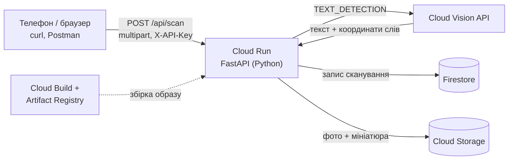

# Container OCR: номер контейнера з фото через Google Cloud Vision

PoC для лабораторної роботи 2 з курсу «Хмарні обчислення». Сервіс приймає фото вантажного
контейнера і через **Google Cloud Vision API** розпізнає текст. Потім він знаходить у тексті
номер контейнера за стандартом **ISO 6346** (наприклад `CSQU 305438 3`), перевіряє контрольну
цифру й виправляє типові помилки OCR. Результат зберігається у **Firestore**, а фото — у **Cloud Storage**.

Розпізнавати можна через REST API (curl, Postman, Swagger UI на `/docs`) або через веб-сторінку,
яка на телефоні одразу відкриває камеру.

## Архітектура



Що відбувається під час одного запиту:

1. Cloud Run отримує фото, повертає його за EXIF-орієнтацією, зменшує до 2400 px і перекодовує в JPEG.
2. Фото надсилається у Vision API (`images:annotate`, функція `TEXT_DETECTION`). Vision повертає
   повний текст і кожне слово з координатами.
3. Сервіс шукає серед слів номер формату `AAAU 000000 0`. Номер може бути в одному слові, розбитий на
   кілька слів або написаний вертикально.
4. Перевіряється контрольна цифра за ISO 6346. Якщо OCR сплутав `O`/`0`, `I`/`1`, `S`/`5`, `B`/`8`,
   сервіс пробує виправити до двох символів, але приймає виправлення лише тоді, коли після нього
   контрольна цифра сходиться.
5. Розшифровується код розміру й типу (`45G1` означає 40 футів, high cube, універсальний).
6. Запис іде у Firestore (колекція `scans`), фото й мініатюра — у бакет Cloud Storage.

## Структура

| Файл | Що це |
|---|---|
| `app/main.py` | FastAPI: ендпоінти, API-ключ, обробка помилок |
| `app/ocr.py` | виклик Cloud Vision API |
| `app/iso6346.py` | пошук номера, контрольна цифра, виправлення помилок OCR, код типу |
| `app/store.py` | історія: Firestore + Cloud Storage (або пам'ять для локального запуску) |
| `app/images.py` | EXIF-орієнтація, зменшення, мініатюра |
| `app/static/index.html` | веб-сторінка для демо |
| `deploy.sh` / `cleanup.sh` | розгортання і видалення в GCP |
| `tests/` | 42 тести (pytest), Vision, Firestore і Storage підмінено |
| `samples/` | синтетичні фото дверей контейнера для перевірки |
| `samples/real/` | справжні фото з Wikimedia Commons з відомими номерами, результати й атрибуція в [README](samples/real/README.md) |

## Розгортання (Cloud Shell, приблизно 10 хвилин)

Потрібен лише проєкт GCP з активним Free Trial.

1. Відкрийте [console.cloud.google.com](https://console.cloud.google.com), виберіть проєкт і натисніть
   кнопку **Activate Cloud Shell** (`>_` праворуч угорі). Відкриється термінал, де `gcloud` вже
   встановлений і залогінений.
2. Перенесіть туди код. Є два способи:
   - через GitHub (його все одно треба для здачі): `git clone https://github.com/<ви>/container-ocr.git`;
   - або в меню Cloud Shell (⋮) вибрати **Upload**, завантажити `container-ocr.zip` і виконати `unzip container-ocr.zip`.
3. Запустіть:

   ```bash
   cd container-ocr
   gcloud config set project <PROJECT_ID>
   bash deploy.sh
   ```

Скрипт вмикає потрібні API, створює базу Firestore, бакет, сервісний акаунт з мінімальними
ролями та API-ключ, збирає контейнер і деплоїть його в Cloud Run. Наприкінці він друкує адресу
сторінки та API-ключ. Ключ також зберігається у файлі `.api_key`. Повторний запуск просто
викладає нову версію коду.

> Якщо перший деплой впав з помилкою прав (`PERMISSION_DENIED` під час збірки), зачекайте 2–3
> хвилини і запустіть `bash deploy.sh` ще раз: щойно видані ролі IAM застосовуються не одразу.

## Як користуватися

**Веб-сторінка.** Відкрийте адресу з виводу скрипта (на телефоні теж), введіть API-ключ угорі
і сфотографуйте двері контейнера або виберіть фото. Фото з інтернету можна вставити з буфера
(Ctrl+V). На фото жовта рамка показує, де знайдено номер, а пунктир — код типу.

**curl:**

```bash
URL=https://container-ocr-xxxxx.europe-west1.run.app
KEY=$(cat .api_key)

curl -s -H "X-API-Key: $KEY" -F file=@samples/door_valid.jpg "$URL/api/scan"
curl -s -H "X-API-Key: $KEY" "$URL/api/scans?limit=5"
```

**Postman:** `POST {URL}/api/scan`, вкладка Body → form-data, ключ `file` типу File, заголовок `X-API-Key`.

**Swagger UI:** `{URL}/docs`. Натисніть Authorize, вставте ключ, потім `POST /api/scan` → Try it out.

### Ендпоінти

| Метод | Шлях | Опис |
|---|---|---|
| `POST` | `/api/scan?mode=text\|document&save=true` | розпізнати фото (поле `file`) |
| `GET` | `/api/scans?limit=20` | останні сканування з Firestore |
| `GET` | `/api/scans/{id}` | одне сканування |
| `GET` | `/api/scans/{id}/image?thumb=1` | фото з Cloud Storage |
| `GET` | `/api/info` | налаштування сервісу (без ключа) |
| `GET` | `/docs` | OpenAPI / Swagger UI |

Приклад відповіді `POST /api/scan` (скорочено):

```json
{
  "id": "20261009-201405-a1b2c3",
  "status": "valid",
  "container": {
    "number": "CSQU3054383",
    "formatted": "CSQU 305438 3",
    "owner_code": "CSQ",
    "category": "U",
    "category_name": "вантажний контейнер",
    "serial": "305438",
    "check_digit": 3,
    "expected_check_digit": 3,
    "check_digit_read": true,
    "valid": true,
    "corrected": false,
    "box": [640, 129, 1258, 239]
  },
  "size_type": {"code": "45G1", "length": "40 футів",
                "height": "9 футів 6 дюймів (high cube)", "type": "універсальний (general purpose)"},
  "candidates": ["..."],
  "image": {"width": 1600, "height": 1200},
  "text": "CSQU 305438 3\n45G1\nMAX. GROSS 30,480 KG ...",
  "timings_ms": {"prepare": 40, "ocr": 650, "total": 820},
  "stored": true,
  "image_stored": true
}
```

Можливі значення `status`:

| status | Що означає |
|---|---|
| `valid` | номер знайдено, контрольна цифра сходиться |
| `invalid_check_digit` | номер знайдено, але цифра не сходиться (OCR помилився або номер нанесено з помилкою) |
| `check_digit_missing` | код власника й серійний номер прочитано, а цифру в рамці — ні; її обчислено |
| `not_found` | номера в тексті немає |

## Як працює контрольна цифра (для слайда)

Перші 10 символів переводяться в числа: цифри залишаються як є, а літери отримують значення
A=10, B=12, C=13 … Z=38, причому значення, кратні 11 (11, 22, 33), пропускаються. Кожне число
множиться на 2 у степені позиції (1, 2, 4 … 512), усе додається і береться остача від ділення на 11.
Якщо вийшло 10, контрольна цифра 0.

Приклад для `CSQU 305438`: 13·1 + 30·2 + 28·4 + 32·8 + 3·16 + 0·32 + 5·64 + 4·128 + 3·256 + 8·512 = 6185;
6185 mod 11 = **3**.

## Вартість

Для лаби все вкладається в безкоштовні ліміти, а решту покриває кредит Free Trial:

- **Vision API:** перші 1000 запитів `TEXT_DETECTION` на місяць безкоштовні.
- **Cloud Run:** 2 млн запитів на місяць безкоштовно, і поза запитами сервіс масштабується до нуля.
- **Firestore:** 50 тис. читань і 20 тис. записів на день безкоштовно.
- **Cloud Storage:** безкоштовний ліміт діє лише в регіонах США, тож у Європі фото коштують частки цента.

`--max-instances 2` і API-ключ захищають від того, щоб хтось сторонній витратив квоту.

## Демо-відео (план, приблизно 2 хвилини)

1. Сторінка на телефоні: сфотографувати контейнер (або екран з фото) і показати номер та зелену позначку.
2. Фото, де OCR помиляється або цифру не видно: показати червоний чи сірий статус і пояснення.
3. Термінал: запит через `curl` і JSON-відповідь.
4. `/docs`: Swagger UI.
5. Консоль GCP: Firestore → колекція `scans` із записами; Cloud Storage → фото; Cloud Run → логи і метрики.

## Структура презентації

1. Задача: ручне введення номерів контейнерів на терміналах і складах дає помилки.
2. Сфери застосування: в'їзд на термінал (gate check), інвентаризація складу, огляд і фіксація
   пломб, митний контроль, звірка з накладними.
3. Google Cloud Vision API: можливості (OCR, мітки, обличчя, логотипи, SafeSearch), різниця
   між `TEXT_DETECTION` і `DOCUMENT_TEXT_DETECTION`, формат запиту й відповіді, ціни.
4. Архітектура PoC: схема вище, ролі сервісів, IAM (окремий сервісний акаунт з мінімальними правами).
5. Стандарт ISO 6346 і контрольна цифра: приклад розрахунку.
6. API сервісу: ендпоінти, приклад запиту й відповіді.
7. Демо-відео.
8. Обмеження і що можна покращити: вертикальні написи, бліки, брудні фото; Document AI або
   власна модель на Vertex AI; Secret Manager для ключа; автентифікація через Identity Platform.
9. Висновки і посилання на GitHub.

## Локальний запуск (необов'язково)

```bash
python -m venv .venv && source .venv/bin/activate
pip install -r requirements.txt pytest httpx
pytest                                     # тести без доступу до GCP

gcloud auth application-default login      # щоб викликати справжній Vision з ноутбука
gcloud auth application-default set-quota-project <PROJECT_ID>
uvicorn app.main:app --reload              # http://127.0.0.1:8000, історія в пам'яті
```

## Після захисту

```bash
bash cleanup.sh
```

Скрипт видаляє сервіс Cloud Run, бакет із фото, сервісний акаунт і зібрані образи.
